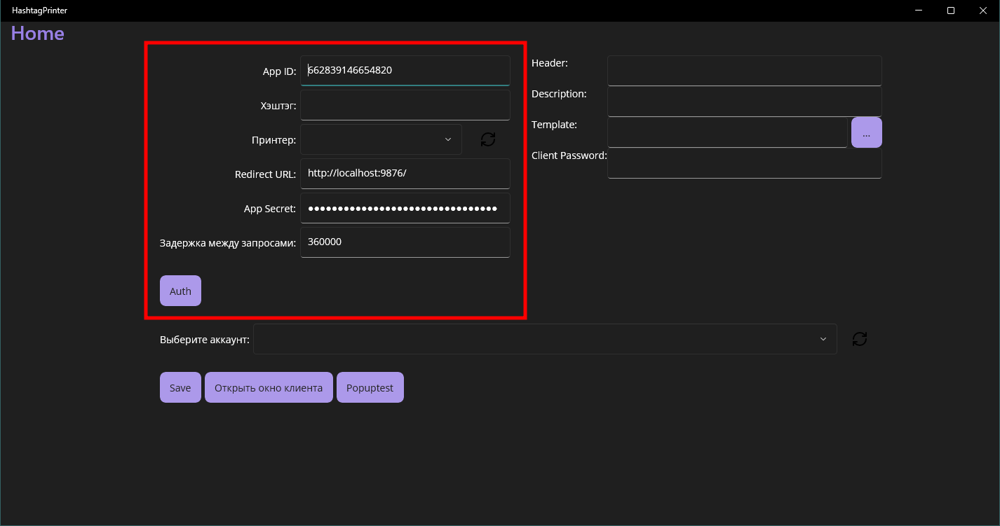
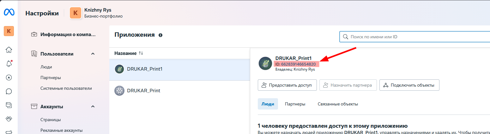
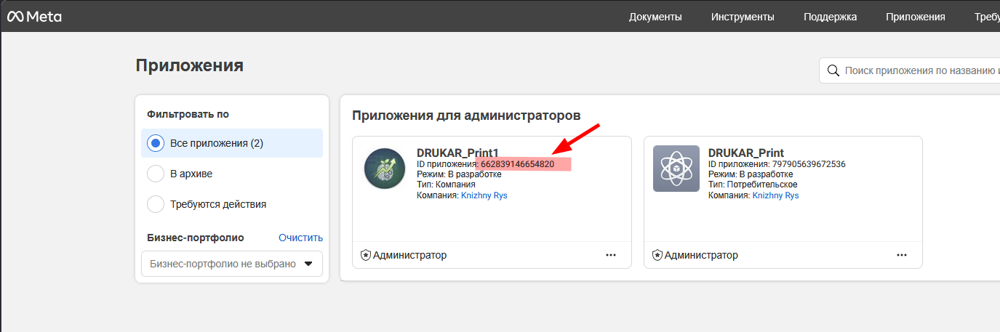
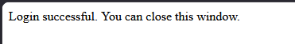
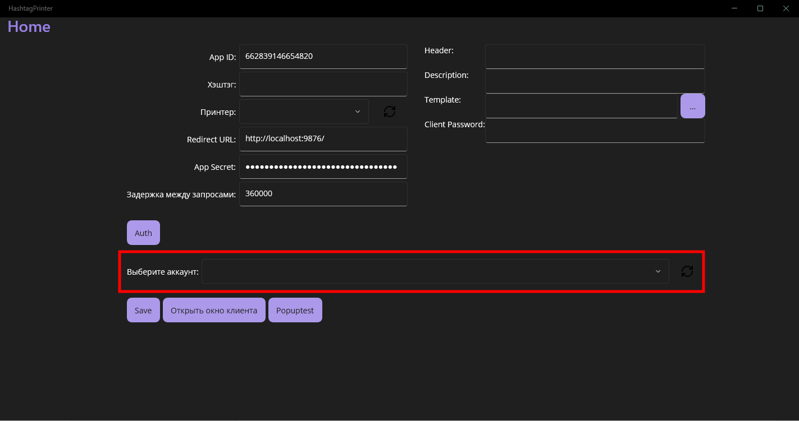
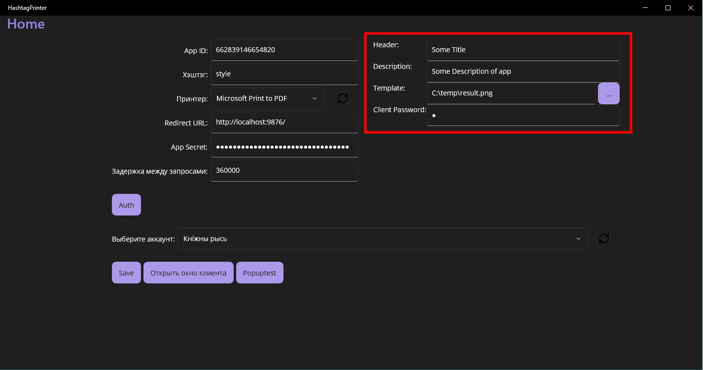
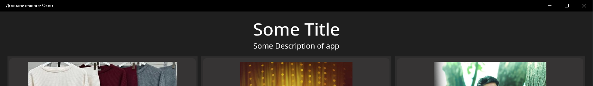
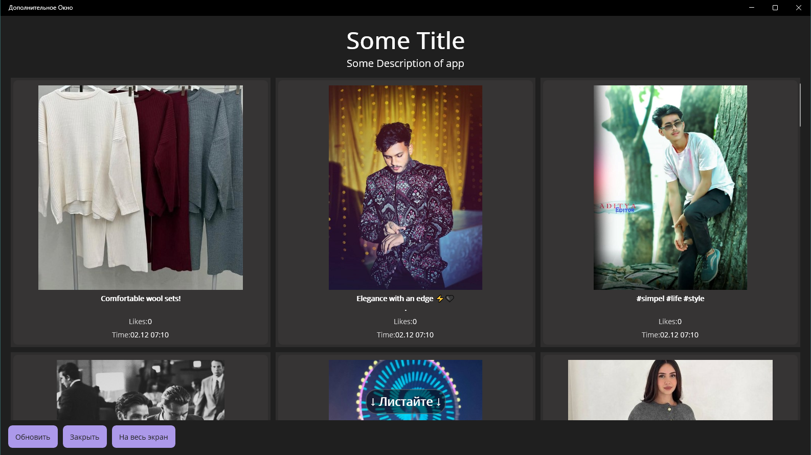

## Зависимости
Перед запуском возможно потребуется установить 
[.NET 9.0 Desktop Runtime (v9.0.11) - Windows x64](https://dotnet.microsoft.com/en-us/download/dotnet/thank-you/runtime-desktop-9.0.11-windows-x64-installer?cid=getdotnetcore)

## Запуск
Запустить *HashtagPrinter.exe*

## Настройка
### Перед авторизацией

- **AppID** не меняем. Если случайно стёрли или изменили ID, актуальный берём: 
    - на странице [бизнес-портфолио](https://business.facebook.com/latest/settings/apps)
        
    - или на [странице приложений](https://developers.facebook.com/apps/)
        
- Устанавливаем **Хэштэг**
- Выбираем принтер
- **Redirect URL** не меняем
- **App Secret** не меняем. Если сменили и не работает ничего, ищем актуальный на странице [настроек приложения](https://developers.facebook.com/apps/662839146654820/settings/basic/)
- Задержку между запросами оставляем как есть: 330000 (не менее)
### Авотризация
Нажимаем кнопку Auth. Откроется браузер по умолчанию и будет предложено авторизоваться при помощи Facebook. После авторизации, переблосит на страницу, указанную в Redirect URL с сообщением 
> Login successful. You can close this window.

Кнопка **Auth** после успешной авторизации снова станет активной.

После успешной авторизации, *выбираем бизнес-аккаунт* в поле выбора аккаунта

> [!IMPORTANT]
> Обязательно сохраняем настройки
### Настройка полей справа

- Поля **Header** и **Description** используюся для вывода кастомной информации на клиентском окне:
    
- Поле **Template** задаёт шаблон, который будет использован подложкой под фотографию при печати. Поддерживаются основные форматы изображений
- **Client Password** задаёт пароль, который потребуется для закрытия клиентского окна при полноэкранном режиме

## Клиентское окно

- Кнопка **Обновить** используется для принудительного запроса новых фотографий
- Кнопка **Закрыть**, позволяет закрыть окно, когда оно в полноэкранном режиме. Если установлен Client Passowd, то вводим его в поле ввода пароля (появляется при нажатии на кнопку Закрыть) и нажимаем Enter, если не установлен - просто нажимаем Enter
- Кнопка **На весь экран** разворачивает клиентское окно на весь экран

При клике на изображение открывается окно печати